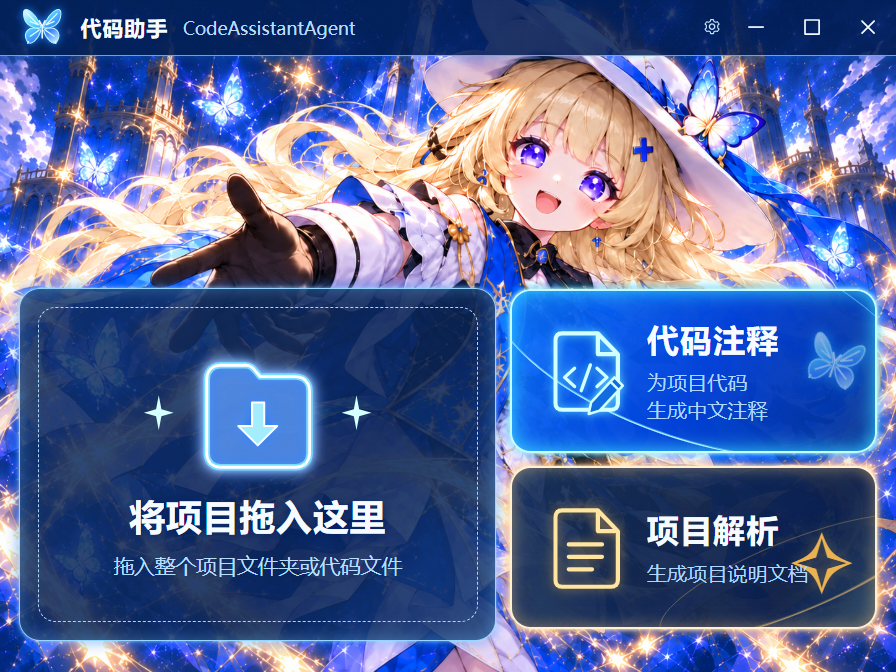

# CodeAssistantAgent · 本地代码助手

基于 HelloAgents 的桌面代码助手，通过蓝金主题客户端完成代码中文注释、项目解析、修改审阅和测试验证。项目目录遵循共创规范：`minibeartwo-CodeAssistantAgent`。

当前版本为可运行的 MVP：Electron 客户端会启动并管理本地 Python 服务。接入兼容模型后，可以在自己的项目中提问、审阅补丁、应用修改并查看实际测试结果。



点击菲比桌面挂件打开此客户端，默认窗口为 650×500，界面整体以 65.625% 显示，最小可调整到 640×480，可拖入项目文件夹或代码文件。选择“代码注释”或“项目解析”后，在同一蓝色界面的任务面板中确认需求并开始处理；关闭面板后可点击“继续任务”恢复任务或草稿。原有 IDE 工作台界面及编辑器依赖已经移除。

[查看任务面板截图](docs/screenshots/client.png)。截图来自本地协议测试：修改经过实际审阅和应用，测试输出来自真实 pytest；模型端使用确定性的测试服务。

## 已实现的功能

- 菲比啾比桌面挂件：待机保留用户选定的 3D 人物图，悬停时双手背后、前倾歪头探看，点击时闭眼笑着小跳；单击展开或收起客户端，拖动调整位置，右键打开菜单和退出。
- 蓝金主题首页：项目拖入、代码中文注释、项目说明文档入口；无边框标题栏支持拖动、最小化、最大化和关闭。
- 拖入本地项目或代码文件，在两个功能面板中配置需求、查看任务活动与结果。
- HelloAgents LLM 流式适配与 ToolRegistry 工具调度；应用负责有预算的 Agent 循环。
- 生成补丁后暂停，在任务面板中按文件查看差异并接受或拒绝；接受后继续验证。
- 文件发生外部变化时保留当前内容，重新读取并生成补丁。
- 运行当前任务预先授权的 Python/npm 测试与构建，显示真实输出和退出码。
- 取消任务、停止命令进程树；累计调用次数与执行时间预算。
- SQLite 保存会话、任务、递增事件及补丁检查点；支持事件重连与补丁撤销。
- 模型设置页；API Key 优先存入系统凭据库，无法使用凭据库时保存在内存。

## 技术栈与架构

| 层次 | 实现 |
| --- | --- |
| 桌面外壳 | Electron，主进程管理窗口、目录选择与 Python 服务 |
| 交互界面 | React、TypeScript、Vite，统一蓝金主题首页和任务面板 |
| 本地服务 | Python 3.11+、FastAPI、Uvicorn、HTTP + SSE |
| Agent | HelloAgents 0.2.9 的 HelloAgentsLLM 与 ToolRegistry，自定义可恢复循环 |
| 工具与数据 | rg / Python 文本检索、Git、受限命令入口、SQLite、keyring |

客户端页面通过 Preload 暴露的固定接口调用主进程；主进程通过随机令牌连接 `127.0.0.1` 上的服务，令牌不暴露给页面。界面资源随应用构建，运行时不依赖在线编辑器资源。

[架构图](docs/diagrams/architecture.png) · [流程图](docs/diagrams/workflow.png) · [时序图](docs/diagrams/sequence.png) · [设计图说明](docs/diagrams/README.md)

图中的 Skills、MCP、完整工作区隔离属于后续扩展；当前版本直接操作用户选中的项目，提供路径边界和文件版本校验。

## 快速开始

以下命令在本项目目录执行：

```powershell
cd "E:\hello agents\hello-agents\Co-creation-projects\minibeartwo-CodeAssistantAgent"
```

需要 Python 3.11+ 和 Node.js 22.12+。Windows 为当前验证平台；Git、rg 可选，缺少 rg 时使用有范围限制的 Python 文本检索。

首次安装：

```powershell
powershell -NoProfile -ExecutionPolicy Bypass -File .\setup.ps1 -Dev
```

`-Dev` 安装 pytest 等测试依赖，方便运行示例。只使用问答与编辑时可省略；另加 `-Notebook` 可安装 JupyterLab。

启动：

```powershell
powershell -NoProfile -ExecutionPolicy Bypass -File .\start.ps1
```

已经完成安装后，可以直接执行启动命令。启动后会在桌面右侧显示悬浮气泡，单击打开客户端，再次单击收起。关闭客户端窗口会回到气泡，会话、未保存的编辑和后台任务继续保留；右键气泡选择“退出代码助手”才会退出并停止本地 Python 服务。

气泡可以拖动，松开后记住位置；客户端展开时会贴近菲比气泡显示，根据当前显示器的可用区域自动选择左右或上下位置，并避开屏幕边缘。移动气泡后，下次展开会使用新位置；手动最大化的窗口保留最大化状态。屏幕分辨率或显示器发生变化时，会自动调整到可见区域。重复启动会唤起已有客户端，不会再开一套后台服务。当前没有启用开机自启动。

待机沿用用户提供的 3D 菲比啾比原图。挂件按屏幕刷新节奏连续播放，使用相同落脚位置和头身关键点衔接姿态；点击的蓄力、腾空、落地与恢复由同一时间线控制，同时立即展开或收起客户端。快速移入、移出或连续点击会从当前画面接续；按压和拖动保持当前姿态，拖动抑制点击反馈。系统“减少动态效果”模式使用静态反馈。[查看贴图和制作说明](desktop/electron/assets/README.md)。


开发时启动热更新：

```powershell
.\start.ps1 -Dev
```

如果 Electron 二进制下载受网络影响，可以在当前 PowerShell 会话设置镜像后重新安装：

```powershell
$env:ELECTRON_MIRROR = "https://npmmirror.com/mirrors/electron/"
.\setup.ps1 -Dev
```

脚本只使用项目的 `.venv`，不会安装到系统 Python。若使用其他 Python 环境，可通过 `CODE_ASSISTANT_PYTHON` 指定解释器完整路径。

## 模型配置

启动后点击右上角“设置模型”，填写：

1. API 地址：模型服务的兼容接口根地址，通常以 `/v1` 结尾。
2. 模型名称：服务商或本地服务提供的模型 ID。
3. API Key：云端服务需要；本机无鉴权服务可留空。
4. 调用次数和执行时间上限。

当前使用 Chat Completions 的流式文本协议，由模型按提示返回工具动作 JSON。需要选择能够遵循结构化指令的模型；尚未对所有服务商做兼容验证。

也可以复制 `.env.example` 为 `.env`，填写 `LLM_MODEL_ID`、`LLM_BASE_URL`、`LLM_API_KEY`。已保存的界面配置优先于环境中的模型名称和地址。密钥不会返回给界面或写入 SQLite；本地模型连接会绕过系统代理。

## 使用示例

只读任务可以输入：

> 介绍这个项目的入口和主要模块，并指出相关文件。

> 解释当前文件的职责，找出可能遗漏的边界情况。

修复流程可使用内置的 [buggy-calculator 示例](examples/buggy-calculator/README.md)：

1. 在客户端导入 `examples/buggy-calculator` 文件夹或其 `calculator.py` 文件。
2. 点击“代码注释”，填写注释需求；也可以补充：“检查 add 的计算错误，保留函数签名并验证。”
3. 在任务面板勾选“允许此任务运行测试”，填写 `python -m pytest -q`，点击“开始注释”。
4. 查看按文件展示的修改差异，点击“接受并应用”；助手随后可运行授权测试。
5. 在“运行输出”查看实际结果。任务结束后可在同一面板撤销补丁；“历史任务”可重新查看记录。

这个示例故意包含错误，修复前测试失败。任务结果取决于所连接的模型，测试输出来自实际进程。

测试入口支持 `python -m pytest/unittest/compileall`、`pytest` 和 `npm test` / `npm run test/build/lint/typecheck`。命令按空白拆分，当前不支持带空格的引号参数。Python 测试使用后端解释器，需要在该环境安装目标项目的测试依赖。

## Notebook

按共创要求保留 [main.ipynb](main.ipynb)。Notebook 复用真实的 Workspace、Store 和 Patches 模块，在临时目录演示读取、生成补丁、审阅前不写入、应用、运行 unittest 和撤销，无需模型密钥。

```powershell
.\setup.ps1 -Notebook
.\.venv\Scripts\python.exe -E -m jupyterlab main.ipynb
```

## 项目结构

```text
minibeartwo-CodeAssistantAgent/
├── README.md
├── main.ipynb
├── requirements.txt
├── requirements-dev.txt
├── requirements-notebook.txt
├── setup.ps1 / start.ps1
├── backend/
│   ├── app.py / __main__.py   # 鉴权 API、SSE 与服务入口
│   ├── runtime.py            # 任务循环、预算、暂停与恢复
│   ├── model.py / settings.py
│   ├── workspace.py          # 路径边界、检索、文件与 Git
│   ├── patches.py            # 补丁、基线校验、检查点与撤销
│   └── commands.py / store.py
├── desktop/
│   ├── electron/             # 主进程与 Preload
│   ├── src/                  # 蓝金首页、功能任务面板与模型设置
│   ├── scripts/              # 开发启动与桌面集成测试
│   └── package-lock.json
├── tests/
├── examples/buggy-calculator/
└── docs/diagrams/
```

依赖、构建产物和测试临时文件均在本项目内，并由项目的 `.gitignore` 排除。正常使用时，会话数据库保存在 Electron 用户数据目录的 `service/state.sqlite3`；可通过 `CODE_ASSISTANT_DATA_DIR` 指定位置。记录中可能包含读取过的代码与补丁内容。

## 验证

```powershell
.\.venv\Scripts\python.exe -E -X utf8 -m pytest -q
cd desktop
npm run build
npm run test:desktop
npm run test:bubble
```

后端测试覆盖鉴权、路径穿越和私密文件过滤、保存冲突、审阅后运行真实测试、事件重放、冲突重新生成、撤销保护、取消、累计步数与检查点恢复。

桌面测试会创建独立的测试工作区和本地协议服务，启动实际 Electron 窗口，检查项目拖入、代码注释与项目解析两个功能、HelloAgents 流式调用、补丁审阅、真实 pytest、撤销及重启历史，同时确认没有旧工作台界面。临时文件和截图位于 `.test-artifacts/`。它不使用真实云端模型，不代表模型生成质量评测。

当前验证结果：Windows、Python 3.11、Node.js 24 下，14 项后端测试通过，TypeScript/Vite 构建通过，Electron 完整流程测试通过，Notebook 全部代码单元运行通过。依赖中仍有 Starlette 测试客户端和 HelloAgents/Pydantic 的弃用提示。

气泡集成测试另覆盖贴图透明度、连续画面与落脚位置、悬停反转、点击升降和连续触发、键盘和减少动态效果模式，以及显示/收起、关闭后保留状态、拖动与松手位置保存、Windows 缩放及屏幕边界、菜单退出和服务清理、重启恢复。测试使用真实 Electron 窗口与 IPC；拖动时的系统光标坐标使用可控替身。

## 当前边界与后续计划

- 工具仅处理 UTF-8 文本；文件读取上限 256 KB，模型读取及完整文件补丁限制为单文件 24000 字符、每批最多 5 个文件。检索范围最多 800 个文件、60 条结果，暂未提供向量索引和大型仓库全量检索。
- 文件工具屏蔽常见密钥、数据库和依赖目录，校验解析后的路径。命令入口只接受列出的测试/构建类型；项目测试本身会执行本地代码，因此当前不提供操作系统级沙箱。
- 应用/撤销使用逐文件原子替换与持久化检查点；跨多个文件的操作无法保证断电原子性。重启后“需要恢复”的补丁可在结束任务后撤销，外部修改发生冲突时不会覆盖。
- 执行中的任务在服务重启后标记中断，等待审阅的补丁会保留；不会自动重跑可能已有副作用的命令。
- 本地取消会停止调度和命令进程树；已发给远端的模型请求能否停止计费由服务商决定。
- 尚未实现自动补全、完整 LSP、Skills/MCP、Git worktree 隔离及安装包发布。后续可按已确认架构扩展。

## 作者与共创规范

作者：[@minibeartwo](https://github.com/minibeartwo)。

遵循 [Hello-Agents 共创项目要求](../README.md)，保留 README、requirements.txt 和 main.ipynb。感谢 Datawhale Hello-Agents 教程与社区提供的学习资料。

许可证遵循共创区要求：[CC BY-NC-SA 4.0](https://creativecommons.org/licenses/by-nc-sa/4.0/)。
