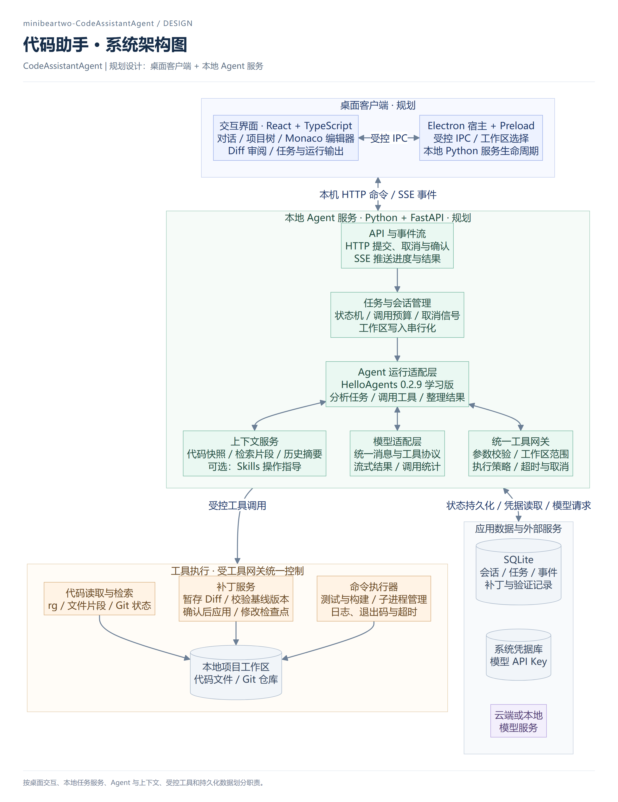
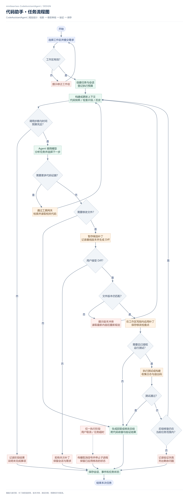
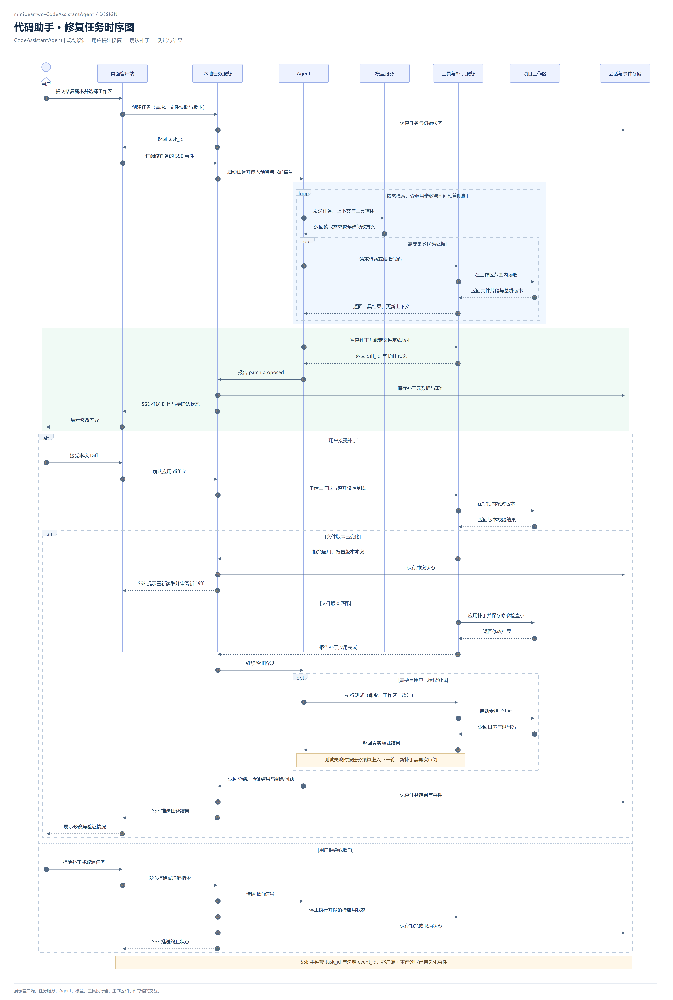

# CodeAssistantAgent 设计图

本目录保存已确认的架构图、任务流程图和时序图，格式均为 PNG。主流程已有可运行的 MVP；图中的 Skills/MCP 扩展、完整工作区隔离和安装包仍是后续计划，当前实现范围见[项目说明](../../README.md)。

## 系统架构图

采用 Electron + React/TypeScript + Monaco 桌面客户端，以及 Python + FastAPI 本地服务；通过适配层使用 HelloAgents 0.2.9 学习版的 LLM 和 ToolRegistry。应用负责可持久化的 Agent 循环、审阅暂停、代码检索、补丁、测试、会话与凭据管理。

## 任务流程图

从工作区选择和需求提交开始，区分只读问答与代码修改。修改需要经过 Diff 审阅和文件基线校验；测试失败时，在任务范围和预算内继续修复。取消或超时会停止执行并保存实际状态。

## 修复任务时序图

展示一轮修复任务中的任务创建、事件订阅、模型与工具调用、补丁确认、版本冲突和验证结果。测试失败后的下一轮修复参照流程图执行，新补丁需要重新审阅。

SSE 事件携带任务 ID 和递增事件 ID，支持客户端重连读取 SQLite 中已保存的事件。

